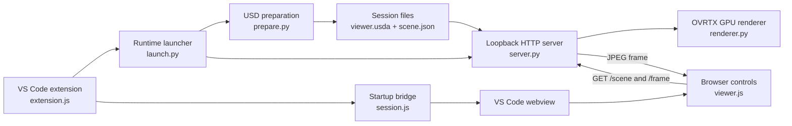

# OVRTX Viewer

Open a USD scene in a VS Code or Cursor tab and inspect it with NVIDIA RTX rendering.
Orbit, pan, zoom, and switch between perspective, top, and front views. The viewer
loads `.usd`, `.usda`, and `.usdc` files without saving changes to the source scene.

## How it works

The VS Code extension prepares a read-only USD overlay, starts the OVRTX renderer
on the GPU host, and embeds its loopback HTTP viewer through VS Code port
forwarding. The browser controls the camera but does not receive scene geometry:
each interaction requests a server-rendered JPEG.



For a detailed interactive version, see
[`docs/ovrtx-viewer-architecture.canvas.tsx`](docs/ovrtx-viewer-architecture.canvas.tsx).
It includes selectable system, startup, and frame-request graphs with links to the
relevant source files.

### Load the interactive architecture Canvas

Cursor compiles Canvas files only from its managed `canvases` directory for the
current workspace; the file in `docs/` is the repository copy. To load it:

1. Clone this repository and open its root folder in Cursor.
2. Open Agent chat and enter:
   `Copy docs/ovrtx-viewer-architecture.canvas.tsx into this workspace's managed canvases directory, then give me a link to open it.`
3. Open the Canvas from the link returned by Agent. It appears beside the chat.

The interactive Canvas is a Cursor feature. Other Markdown viewers can use the
Mermaid graph above, and the tracked `.canvas.tsx` file remains readable source.

## Requirements

- VS Code 1.85 or newer, or a compatible version of Cursor.
- Windows or Linux on the rendering host, with an NVIDIA RTX-capable GPU and a
  supported driver. Check NVIDIA's [hardware and driver requirements](https://nvidia-omniverse.github.io/ovrtx/driver_requirements.html).
- Python 3.12, recommended for the tested environment below.
- The separate `ovrtx`, `ovstage`, `usd-core`, `numpy`, and `Pillow` Python packages.

The extension does not install or bundle the NVIDIA runtime. OVRTX is pre-release
software and has its own license terms. See [NVIDIA's setup guide](https://nvidia-omniverse.github.io/ovrtx/python_api/getting_started.html)
and [third-party notices](THIRD_PARTY_NOTICES.md). Rendering needs a GPU host;
macOS can be used as a client connected to a supported remote host.

## Install in VS Code or Cursor

1. Download `ovrtx-viewer-0.2.0.vsix` from [GitHub Releases](https://github.com/ashleygoldstein/ovrtx-Viewer-VS-Code-Extension/releases),
   or build it using the instructions below. This extension is installed from a VSIX file.
2. Open the Command Palette with **Ctrl+Shift+P** (macOS: **Cmd+Shift+P**).
3. Run **Extensions: Install from VSIX...** and select the file.
4. Reload the editor if prompted. If you already have a development copy of OVRTX
   Viewer installed, disable or uninstall it first to avoid duplicate commands.

VS Code also supports `code --install-extension ovrtx-viewer-0.2.0.vsix`.
For editor-specific help, see [VS Code's extension installation guide](https://code.visualstudio.com/docs/configure/extensions/extension-marketplace#_install-from-a-vsix)
and [Cursor's extension guide](https://cursor.com/help/customization/extensions).

For SSH use, install the extension in the editor's **SSH host** environment. Put
the Python environment and USD files on that same host. The extension runs there
and uses the editor's port forwarding to display the viewer locally. Remote use
has automated forwarding-path coverage; the current GPU validation was on Windows.

## Set up the rendering environment

Create a virtual environment in your scene workspace. These commands install the
versions used for validation; package availability and supported drivers may change.
Install NVIDIA packages only if you accept their terms.

Windows PowerShell:

```powershell
py -3.12 -m venv .venv
& .\.venv\Scripts\python.exe -m pip install --upgrade pip
& .\.venv\Scripts\python.exe -m pip install ovrtx==0.5.0.377615 ovstage==0.2.0.377349 usd-core==26.8 numpy==2.2.6 Pillow==13.0.0
& .\.venv\Scripts\python.exe -c "import sys; print(sys.executable)"
```

Linux:

```bash
python3.12 -m venv .venv
.venv/bin/python -m pip install --upgrade pip
.venv/bin/python -m pip install ovrtx==0.5.0.377615 ovstage==0.2.0.377349 usd-core==26.8 numpy==2.2.6 Pillow==13.0.0
.venv/bin/python -c 'import sys; print(sys.executable)'
```

Open Settings, search for **OVRTX Viewer**, and set both **Python Path** and
**Runtime Python Path** to the full executable path printed by the last command.
Use the executable, not the environment directory. In an SSH window, use paths on
the remote GPU host. Leave **Port** at `0` to choose an available port automatically.
**GPU** defaults to CUDA device `0`.

If both path settings are empty, the extension looks for `.venv/Scripts/python.exe`
on Windows or `.venv/bin/python` on Linux at the workspace root. Explicit settings
are recommended when opening scenes outside that workspace. You may use separate
Python environments: **Python Path** needs `usd-core`; **Runtime Python Path** needs
`ovrtx`, `ovstage`, `numpy`, and `Pillow`. Preparation and rendering run in separate
processes to keep their OpenUSD libraries isolated.

## Open and navigate a scene

1. Open a trusted workspace containing your USD file and its referenced assets.
2. Right-click the file in Explorer and select **OVRTX Viewer: Open USD Scene**,
   or run that command from the Command Palette and choose a file.
3. Watch the **OVRTX Viewer** task terminal while the renderer starts. First shader
   compilation can take several minutes; subsequent starts use cached shaders.
4. Inspect the scene in the viewer tab.

- Drag with the left mouse button to orbit.
- Shift-drag, middle-drag, or right-drag to pan.
- Scroll to zoom; double-click or press **F** to frame the scene.
- Use **Perspective**, **Top**, **Front**, and **Frame all** on the toolbar.
- With the image focused, arrow keys orbit, Shift+arrow keys pan, and **+ / -** zoom.

Opening another scene stops the previous renderer. Reopen a scene to see edits
made on disk. Closing the viewer tab, running **OVRTX Viewer: Stop Viewer**, or
deactivating the extension terminates its task. Hiding the tab keeps the session
available. This is a single-scene inspection viewer; it has no authoring tools or
animation timeline.

## Troubleshooting

- **Set ovrtxViewer.runtimePythonPath:** select the installed environment's full
  Python executable path in Settings. Confirm it exists on the extension host.
- **Missing pxr / ovrtx / ovstage:** install the packages into the exact interpreter
  selected in Settings. Installing into a different system Python will not help.
- **Port is in use:** set **OVRTX Viewer: Port** to `0`. This version also falls back
  to a free port when a configured preferred port is occupied. Reload the editor
  after upgrading if an older version still reports a fixed-port error.
- **Viewer exited / render failed:** read the task terminal and the session's
  `ovrtx.log`. Check the GPU driver, runtime compatibility, and available GPU memory.
- **Scene is empty or materials are missing:** keep relative references and textures
  accessible from the original scene. Custom asset resolvers and plugins must be
  installed separately on the host. Use **Frame all** after navigation.
- **Startup appears stuck:** allow time for initial shader compilation. Startup
  times out after ten minutes; use **Stop Viewer** to cancel it.

## Privacy and files

The HTTP viewer binds only to `127.0.0.1`, uses a random session capability in its
URL, and exposes only its viewer assets, scene metadata, and rendered frames.
Keep forwarded ports private and do not share the session URL. The extension has
no telemetry or upload feature. USD references and the separately installed SDK
may access external resources; open only scenes and plugins you trust.

Generated overlays, scene metadata, preview images, and renderer logs are stored
in the editor's extension storage. The task terminal prints the session directory.
Metadata and logs can contain local paths. After stopping the viewer, you may
delete old session directories to reclaim disk space. They are not part of this
repository or the VSIX. The original USD file is not modified.

## Build and test

Install a current Node.js LTS release. From this repository:

```bash
npm test
npm run package
```

The packaging command downloads Microsoft's `@vscode/vsce` development tool and
writes `ovrtx-viewer-0.2.0.vsix`. Only the files explicitly listed in `.vscodeignore`
are included. No Node packages are needed by the installed extension.

Using a Python environment with `usd-core` and `Pillow`, run:

```bash
python -m unittest discover -s test -p "test_*.py"
python test/audit_release.py
python test/audit_release.py --vsix ovrtx-viewer-0.2.0.vsix
```

Optional browser tests use Playwright with Edge installed: install Playwright as
a development dependency with `npm install --no-save --package-lock=false playwright`,
then run `node test/browser.cjs`. Optional GPU checks are documented in the test
script `test/gpu_soak.py`. Test scenes are generated from basic USD primitives.

The source remains `UNLICENSED`; no open-source grant is implied. See
[THIRD_PARTY_NOTICES.md](THIRD_PARTY_NOTICES.md) before redistributing dependencies.
